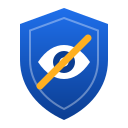

<p align="center">
  
</p>

<h1 align="center">saas-blind-security</h1>

<p align="center">
  Framework de sécurité SaaS assisté par IA : scanners de sécurité automatisés, workflows GitHub et instructions
  avancées pour agents de programmation IA afin d'auditer, détecter, prévenir et corriger les vulnérabilités
  des applications SaaS.
</p>

<p align="center"><a href="README.md">English version</a></p>

---

## Présentation

saas-blind-security est un **framework que l'on installe dans son projet SaaS**, pas une simple collection de
prompts :

- **Contrôles exécutables** — `scripts/security-check.sh` détecte la stack, lance tous les scanners compatibles
  disponibles, normalise les résultats, applique un seuil de gravité bloquant et produit un rapport Markdown.
- **Workflows CI** — CodeQL, Semgrep, Snyk, OWASP ZAP, Dependency Review et Dependabot, avec permissions
  minimales et actions épinglées par SHA.
- **41 règles Semgrep dédiées aux SaaS** (injections SQL/NoSQL, pistes IDOR, mass assignment, JWT, webhooks de
  paiement non signés, SSRF, path traversal, XSS, cryptographie faible, secrets), toutes testées.
- **Instructions pour agents IA** — un [`CLAUDE.md`](CLAUDE.md) complet (méthode en cinq phases) et 12
  [compétences Claude Code](.claude/skills/).
- **Patterns Fabric** — 9 patterns originaux pour [Fabric](https://github.com/danielmiessler/Fabric).
- **Modèles** — rapport de sécurité, modèle de menace, plan de remédiation, checklist SaaS.

> **Aucun outil ne prouve qu'une application est sécurisée.** Le framework indique quels contrôles ont été
> exécutés, lesquels ne l'ont pas été, et marque chaque résultat comme *non vérifié* tant qu'il n'est pas confirmé.

## Méthode en cinq phases

1. **Reconnaissance** (lecture seule) : stack, points d'entrée, authentification, multi-tenant, paiements, données.
2. **Analyse** : modèle de menace, scanners, revue manuelle selon la liste des risques SaaS.
3. **Classification** : `CRITICAL` / `HIGH` / `MEDIUM` / `LOW` / `INFO` et statut `CONFIRMED` / `POTENTIAL` /
   `FALSE_POSITIVE` / `NOT_VERIFIED`, avec fichier, ligne, impact, conditions d'exploitation, preuve et correction.
4. **Remédiation** : test d'abord, correction minimale ; ne jamais affaiblir une protection pour faire passer un test.
5. **Validation** : nouvelle analyse, tests, comparaison avant/après, rapport final où les vulnérabilités non
   corrigées restent visibles.

## Outils intégrés

| Outil | Où | Token |
|---|---|---|
| GitHub CodeQL | `codeql.yml` | non |
| Secret scanning, push protection, alertes Dependabot, protection de branche | `scripts/configure-github-security.sh` | non (GitHub CLI administrateur) |
| Dependabot | `.github/dependabot.yml` généré | non |
| Semgrep + règles SaaS | `semgrep.yml`, `security-audit.yml`, local | non |
| Snyk (Open Source, Code, IaC) | `snyk.yml`, local | **oui — `SNYK_TOKEN`** (optionnel) |
| OWASP ZAP (baseline, full scan manuel) | `zap-baseline.yml`, `zap-full-scan.yml`, Docker local | non |
| npm audit / composer audit | local, `security-audit.yml` | non |
| Fabric | local, optionnel | votre fournisseur d'IA |

## Installation rapide

```bash
git clone https://github.com/IbrahimCodeur/saas-blind-security.git
cd saas-blind-security
./scripts/install.sh ../mon-saas
cd ../mon-saas
./.saas-blind-security/scripts/security-check.sh --check-only
./.saas-blind-security/scripts/security-check.sh --report
```

Guide détaillé : [docs/fr/installation.md](docs/fr/installation.md) · documentation complète (anglais) :
[docs/](docs/installation.md).

## Limites connues

- Un scan sans alerte n'est pas une preuve de sécurité.
- La logique métier (autorisations, isolation entre clients, facturation) exige une revue manuelle ou par agent.
- CodeQL ne prend pas en charge PHP ; les règles Semgrep sont des motifs, sans suivi de flux inter-fichiers.
- Snyk nécessite un compte ; ZAP n'est pas authentifié par défaut ; le full scan est actif et réservé aux
  environnements de test autorisés.
- La détection de stack est heuristique.

Liste complète : [README.md → Known limitations](README.md#known-limitations).

## Licence

[MIT](LICENSE) © 2026 IbrahimCodeur.

## Auteur et mainteneur

**IbrahimCodeur** — créateur et mainteneur initial de saas-blind-security.

Développeur Full-Stack · Ingénieur logiciel · Développeur open source

| | |
|---|---|
| Portfolio | [ibrahimsamake.ml](https://www.ibrahimsamake.ml) |
| GitHub | [@IbrahimCodeur](https://github.com/IbrahimCodeur) |
| LinkedIn | [linkedin.com/in/ibrahim-samake-59980517a](https://www.linkedin.com/in/ibrahim-samake-59980517a/) |
| YouTube | [@ibrahimcodeur](https://www.youtube.com/@ibrahimcodeur) |
| TikTok | [@ibrahimcodeur](https://www.tiktok.com/@ibrahimcodeur) |
| Facebook | [neufquatre.flex](https://www.facebook.com/neufquatre.flex) |

---

<p align="center"><sub>Created and maintained by <a href="https://github.com/IbrahimCodeur">IbrahimCodeur</a>.</sub></p>
